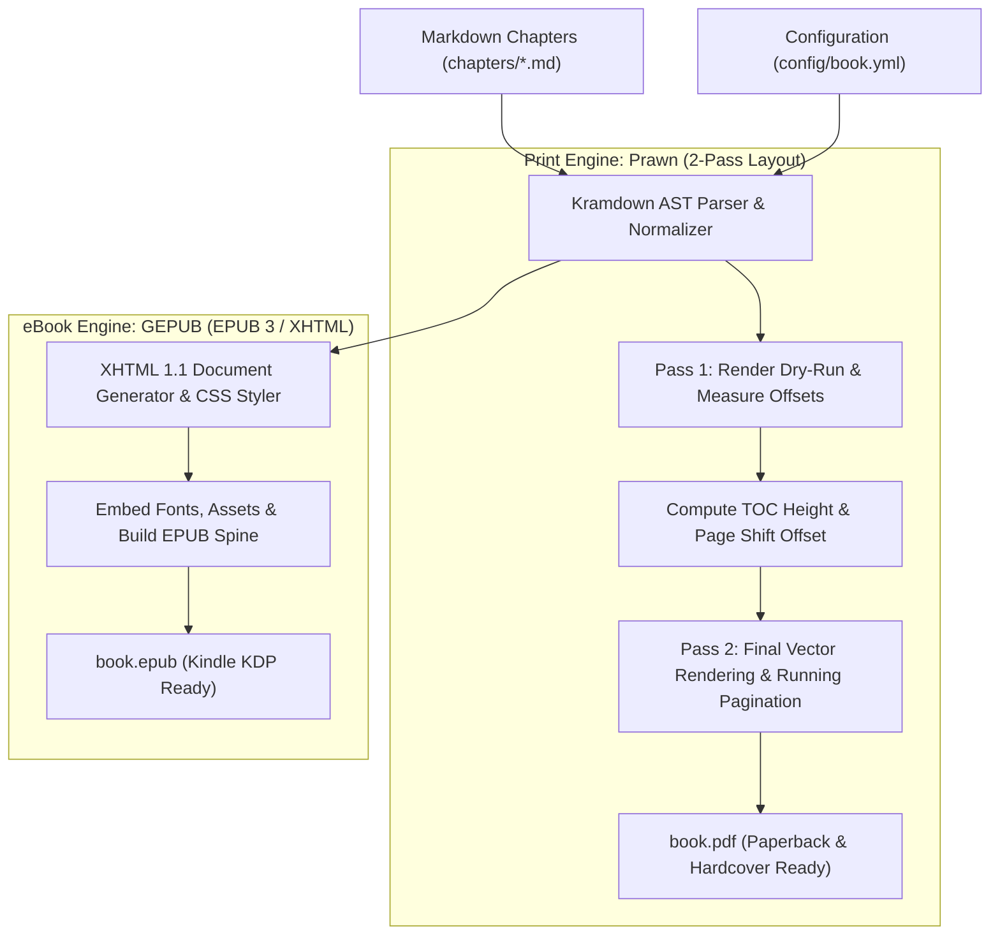

# Booksmith

[](https://rubygems.org/gems/booksmith)
[](https://www.ruby-lang.org)
[](https://kdp.amazon.com)
[](LICENSE.txt)

> **The production-grade, developer-first publishing engine that transforms Markdown chapters into store-ready Paperback, Hardcover, and Kindle eBook (EPUB) editions.**

---

## Overview

Self-publishing technical guides, fiction, or non-fiction on **Amazon Kindle Direct Publishing (KDP)** usually requires painful manual formatting in Word/InDesign or fragile HTML-to-PDF scripts that fail Amazon's automated interior print inspection.

**Booksmith** solves this with a purpose-built, dual-engine compilation pipeline. Written in Ruby, Booksmith reads clean Markdown and compiles it into:
- **Print-Ready PDFs** configured with Amazon KDP-compliant margins, geometry, vector typography, running headers, and dynamically resolved tables of contents.
- **Reflowable EPUB 3 eBooks** bundled with embedded typography, validated navigation manifests, and custom callout styling ready for Kindle ingestion.

---

## 🏆 Battle-Tested in Production

Booksmith isn't a theoretical proof-of-concept—it powers live, commercial titles available on Amazon worldwide across **Paperback**, **Hardcover**, and **Kindle eBook** formats:

| Title | Formats Published | Store Link |
| :--- | :--- | :--- |
| **Modern Applications of Ninjutsu** | Paperback • Hardcover • Kindle | [View on Amazon](https://www.amazon.com/dp/B0HNF1T788/) |
| **Jealousy in the Jungle: Invitation & Rival's Awakening** | Paperback • Hardcover • Kindle | [View on Amazon](https://www.amazon.com/Jealousy-Jungle-Invitation-Rivals-Awakening/dp/B0DY872FHM/) |

> [!NOTE]
> Both titles passed Amazon KDP's automated preflight review, interior gutter/margin validation, and reflowable eBook ingest with **zero formatting rejections**.

---

## ✨ Key Features

- **Dual-Target Compilation**: Generate both print-ready PDF and Kindle-compliant EPUB simultaneously with a single CLI command (`booksmith build --format all`).
- **Two-Pass Dynamic Pagination**: Calculates exact chapter starting pages and table-of-contents page offsets automatically prior to final PDF generation.
- **Self-Contained Typography**: Bundles Google's **Noto Sans** and **Noto Sans Mono** TrueType font families. No external font dependencies or OS-level font installations required.
- **Rich Callout Blocks**:
  - **Standard Callouts**: Automatically styles bold headers into shaded callout blocks.
  - **Alternate Callouts (`{: .alt_blockquote}`)**: Tinted background containers for sidebars and tips.
  - **Exercise Callouts (`{: .exercise_blockquote}`)**: Callout cards with customizable asset icons (e.g., timer/clock) and point-level vertical alignment nudges.
- **Print Layout Control**:
  - `<!-- subtitle: ... -->` for clean chapter metadata without breaking Markdown linters.
  - `<!-- PAGE_BREAK -->` comments for manual page control across physical print layouts.
- **Automated Image Pipeline**: Parses inline Markdown sizing attributes (`"width=350 top=10 bottom=10"`) and rasterizes transparent PNG backgrounds via ImageMagick to prevent black-box PDF rendering artifacts.

---

## 🏗️ Architecture & Engineering Highlights

Booksmith was engineered with a modular, extensible architecture that separates AST parsing, layout geometry calculations, and format-specific document packaging.



### Engineering Design Highlights

#### 1. Two-Pass PDF Pagination & TOC Resolution
Generating a table of contents in print documents presents a circular dependency: adding TOC entries can push chapter pages down, altering the page numbers that the TOC itself displays. Booksmith resolves this with a deterministic two-pass algorithm:
1. **Pass 1 (Measurement)**: Traverses the Kramdown AST in an in-memory Prawn buffer to compute exact chapter heights, section boundaries, and TOC page space.
2. **Pass 2 (Synthesis)**: Applies the computed TOC page offset, injects the generated Table of Contents, formats running page numbers (`page_content_bottom_gap`), and writes the final vector PDF.

#### 2. Vector Typography & Geometry Engine
Instead of relying on web-view wrappers or headless browsers, Booksmith renders directly to PDF primitives using `Prawn`. Text leading, bullet indentations (`list_bullet_indent`, `list_marker_gap`), and callout paddings are calculated in points, producing crisp vector type that meets high-resolution commercial print standards (300+ DPI).

#### 3. Dual-Format AST Translation
Booksmith normalizes Markdown elements into an intermediate AST via Kramdown, then branches execution:
- **PDF Converter** (`Booksmith::PDFConverter`): Translates elements into low-level Prawn cursor calls, handling bounding boxes, font switching, and multi-column icon callouts.
- **EPUB Generator** (`Booksmith::EpubGenerator`): Serializes nodes into strict XHTML, injects embedded CSS, registers the TrueType fonts in the OPF manifest, and packages the complete EPUB 3 archive via GEPUB.

#### 4. Automated Image Pre-processing & Alpha Flattening
PDF renderers and commercial print presses frequently misrender PNG alpha transparency as opaque black blocks. Booksmith reads configuration-driven background colors (`image_flatten_bg_color`) and utilizes ImageMagick to composite transparent images against the target page tone before embedding.

---

## 🚀 Quickstart

### 1. Installation

Install Booksmith via RubyGems:

```sh
gem install booksmith
```

Or add it to your project's `Gemfile`:

```ruby
gem 'booksmith', '~> 1.0'
```

### 2. Initialize a Project

Create a new book directory and initialize the scaffolding:

```sh
mkdir my-masterpiece
cd my-masterpiece
booksmith init
```

This generates the standard project structure:

```
my-masterpiece/
├── assets/
│   └── clock.png                  # Sample exercise callout icon
├── chapters/
│   └── 01_introduction.md         # Starter chapter template
└── config/
    └── book.yml                   # Master typography, metadata & layout config
```

### 3. Build Your Book

Compile your chapters into your target formats:

```sh
# Generate Paperback/Hardcover PDF (default: book.pdf)
booksmith build

# Generate Kindle-ready EPUB (book.epub)
booksmith build --epub

# Generate both formats simultaneously
booksmith build --format all

# Build PDF without cover page
booksmith build --no-cover
```

### 4. Inspect Registered Fonts

```sh
booksmith fonts
```

---

## ⚙️ Configuration Reference

All book layout options, metadata, and typography parameters are managed in `config/book.yml`:

```yaml
---
# Book Metadata
:title: "Modern Applications of Ninjutsu"
:author: "Authored by Leonid Medovyy"

# Font Typography
:title_font: "Noto Sans Mono"
:author_font: "Noto Sans Mono"
:header_font: "Noto Sans"
:subtitle_font: "Noto Sans Mono"
:body_font: "Noto Sans"

# Print & Page Geometry
:blank_page_after_cover: true
:table_of_contents: true
:font_size: 10.0
:line_height: 1.5
:page_numbers: true
:page_number_font_size: 9
:page_content_bottom_gap: 30

# Header Sizing (Points)
:title_font_size: 24
:author_font_size: 18
:h1_font_size: 20
:h2_font_size: 18
:h3_font_size: 14
:h4_font_size: 12

# Callout Boxes & Blockquotes
:blockquote_bg_color: "EEEEEE"
:blockquote_padding: 12
:blockquote_margin_top: 10
:blockquote_margin_bottom: 10

# Exercise Callout with Custom Icon
:exercise_blockquote_bg_color: "EEF3FF"
:exercise_blockquote_image: "assets/clock.png"
:exercise_blockquote_image_width: 18
:exercise_blockquote_image_height: 18
:exercise_blockquote_image_voffset: -2
```

---

## ✍️ Markdown Authoring Guide

Booksmith supports full GitHub Flavored Markdown with custom layout enhancements:

### Chapter Titles & Subtitles
Use standard `#` for chapter titles, followed immediately by an invisible subtitle comment:

```markdown
# CHAPTER I
<!-- subtitle: GETTING STARTED WITH BOOKSMITH -->

Chapter opening text starts here...
```

### Manual Page Breaks
Insert a clean page break anywhere in your manuscript without adding visible artifacts in Markdown viewers:

```markdown
<!-- PAGE_BREAK -->
```

### Styled Callout Boxes

```markdown
> **Pro Tip**
>
> Standard callouts automatically elevate bold first lines into header titles.

> **Sidebar Note**
>
> Alternate shaded callout box for supplementary commentary.
{: .alt_blockquote}

> Hands-On Challenge
>
> Exercise callout displaying the configured icon alongside the prompt:
> - Define the core thesis of your publication
> - Configure print trim sizes in book.yml
{: .exercise_blockquote}
```

### Sized & Centered Images
Specify dimensions and vertical padding directly in image Markdown:

```markdown

```

---

## 📊 Feature Comparison

| Feature | Booksmith | Pandoc / LaTeX | Word / InDesign |
| :--- | :---: | :---: | :---: |
| **KDP Print-Ready Out of the Box** | ✅ Yes | ⚠️ Requires Config | ❌ Manual Formatting |
| **Simultaneous PDF & EPUB Output** | ✅ Yes | ⚠️ Separate Pipelines | ❌ Separate Exports |
| **Dynamic 2-Pass TOC Resolution** | ✅ Built-in | ⚠️ Complex LaTeX Runs | ❌ Manual TOC Updates |
| **Zero External Font Dependencies** | ✅ Bundled TTF | ❌ System Fonts | ❌ System Fonts |
| **Markdown Linter Safe Comments** | ✅ Yes (`<!-- -->`) | ❌ LaTeX Injections | ❌ N/A |
| **Transparent PNG Flattening** | ✅ Automated | ❌ Manual Preprocessing | ⚠️ Manual Flattening |

---

## 🛠️ CLI Command Reference

| Command | Description |
| :--- | :--- |
| `booksmith init` | Scaffolds a new book workspace with directories, default assets, sample chapter, and `book.yml`. |
| `booksmith build` | Builds `book.pdf` with Amazon KDP print specifications. |
| `booksmith build --epub` | Builds `book.epub` with validated navigation and embedded typography. |
| `booksmith build --format all` | Compiles both PDF and EPUB in a single pass. |
| `booksmith build --no-cover` | Omits the title/cover page from generation. |
| `booksmith fonts` | Lists all registered font families available for document rendering. |

---

## 👤 Author

Crafted by **Leonid Medovyy** ([@leouofa](https://github.com/leouofa)).

- **GitHub**: [@leouofa](https://github.com/leouofa)
- **Gem**: [rubygems.org/gems/booksmith](https://rubygems.org/gems/booksmith)

---

## 📄 License

This project is open-source under the [MIT License](LICENSE.txt).
